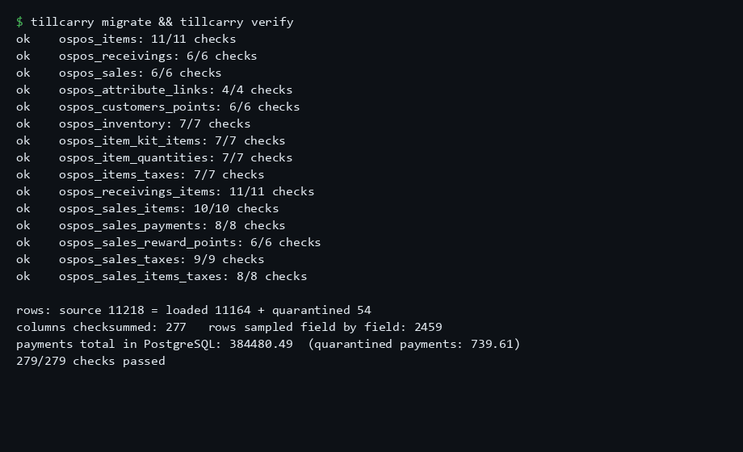
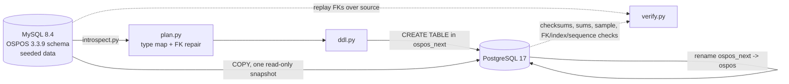

# tillcarry

A technical assessment of a real open source PHP/CodeIgniter till system, plus a MySQL to PostgreSQL
migration tool with its own verifier, run against that system's real schema and a seeded, invented
dataset built to include the awkward rows a decade of real shop data actually has.


*Real output of `tillcarry migrate && tillcarry verify` against the seeded Open Source Point of Sale
3.3.9 schema (invented data, local docker only); full run in `docs/demo-captured.txt`.*

Built and run on a public open source project with invented data. Never touched a real customer or a
real sale; not a client engagement; not in production anywhere.

## The two parts

**The assessment** (`docs/assessment.md`): a "salvage or rebuild?" review of
[opensourcepos/opensourcepos](https://github.com/opensourcepos/opensourcepos) 3.3.9 (MIT licensed),
covering its architecture, its database, its dependencies against public CVE advisories, offline
security leads with file:line citations, measured test coverage (0.34% of lines, from actually running
its own PHPUnit suite with coverage on), a reuse/refactor/replace decision per area, and a phased
modernization plan with effort ranges. Every number in it was run, not guessed.

**The migration** (`src/tillcarry/`): reads OSPOS's own MySQL schema, builds a type-mapped PostgreSQL
schema (decimal money kept exact, `tinyint(1)` resolved to `boolean` only where the data proves it is
one, case-insensitive unique keys mapped to `citext`), copies the data, quarantines rows whose foreign
key parent is missing into a `_tillcarry_rejects` table with the reason (never drops them silently),
logs every zero or impossible date it had to fix, and then a separate verifier that trusts none of the
migrator's own claims: it replays the foreign keys over the source data itself, checksums every column,
sums every money column to the cent, samples rows field by field, and checks every foreign key, index
and sequence in the target.

## Run it

Needs Docker and Python 3.11+.

```bash
git clone <this repo> && cd tillcarry
python -m venv .venv && . .venv/Scripts/activate   # or source .venv/bin/activate
pip install -e ".[dev]"
docker compose up -d --wait        # MySQL 8.4 on 13307, PostgreSQL 17 on 15432, local only
tillcarry seed                     # loads the OSPOS 3.3.9 schema into MySQL, fills it with invented data
tillcarry migrate                  # copies MySQL -> PostgreSQL, builds schema "ospos"
tillcarry verify                   # proves nothing was lost; exits 1 on any mismatch
```

## What a real run actually produced

```
$ tillcarry seed
seeded 11218 rows in 39 tables (seed 20261030); manifest: out\seed-manifest.json
emoji into the utf8mb3 schema: {'result': 'rejected', 'error': "1366: Incorrect string value..."}

$ tillcarry migrate
TOTAL                          11218   11164           54                14
Swapped in as schema 'ospos'. Previous schema kept as 'ospos_prev'.

$ tillcarry verify
rows: source 11218 = loaded 11164 + quarantined 54
columns checksummed: 277   rows sampled field by field: 2459
payments total in PostgreSQL: 384480.49  (quarantined payments: 739.61)
279/279 checks passed
```

11,218 source rows, 11,164 loaded, 54 quarantined (every one with a logged reason; none dropped), 14
zero or impossible dates coerced and logged, 279 independent checks, all passing. Run `tillcarry verify`
again after deliberately damaging one row, one cent or one character in PostgreSQL and it fails: that
control is a permanent test (`tests/test_integration.py`, the `test_control_*` functions), not a one off
demo.

## Tests

```bash
python -m pytest -q                        # unit tests, no database needed, ~75 tests
docker compose up -d --wait && python -m pytest -q -m integration   # the full pipeline against the real containers
```

The unit tests cover the type mapping rules (every MySQL type the schema uses, the boolean/smallint
decision, zero-date handling) and the verifier's own canonical forms, independently of the migrator. The
integration suite seeds, migrates, verifies, runs twice to prove it is idempotent, rolls back, and then
deliberately breaks the target eight different ways (a deleted row, a wrong cent, a changed character,
two values swapped between rows, an extra row, a forgotten quarantine entry, a dropped foreign key, a
stale sequence) to prove the verifier actually notices every one, then heals and reverifies.

## Rollback

```bash
tillcarry rollback   # swaps the previous PostgreSQL schema back in; safe to run migrate again after
```

Each `migrate` run builds the new schema alongside the old one and only renames it into place inside one
transaction; the schema it replaces is kept as `ospos_prev`, so a rollback is two renames, not a restore
from backup. Running `migrate` again after a rollback is safe (idempotent): it rebuilds from the current
MySQL source the same way every time.

## Architecture



## What was hard

The schema has one foreign key (`ospos_sales_items_taxes` to `ospos_sales_items`) whose declared parent
column, `sale_id` alone, is not actually unique: MySQL permits this because it only requires the
referenced columns to be a *prefix* of some index, not a full key, while PostgreSQL requires a true
primary or unique key. The migration documents and repairs this (`FK_REPLACEMENTS` in `src/tillcarry/plan.py`)
rather than silently dropping the relationship, and the seeded data plants rows that pass the loose
MySQL version of the key and fail the correct one, specifically to prove the repair is doing something
real (`docs/assessment.md` section 3 has the full story).

## Limits

Invented data only: a real shop's export may have data shapes this seed did not anticipate (the type
map's own `ValueError` on an unrecognised MySQL type is deliberate: it refuses to guess rather than
silently mis-map something new). No licensed static analyzer or dynamic security scanner was run against
OSPOS; the security section of the assessment is offline, grep based leads read and judged by hand, with
one narrow, consented control test, and says so. Full limits list: `docs/assessment.md` section 10.

## Stack

Python 3.11, PyMySQL, psycopg3, pytest; MySQL 8.4 and PostgreSQL 17 in Docker; the assessment's own
metrics and security-lead scripts are plain standard library Python (`scripts/assessment/`).

## License

MIT (`LICENSE`). Schema files under `schema/` are derived from opensourcepos/opensourcepos (also MIT);
see `NOTICE`.
